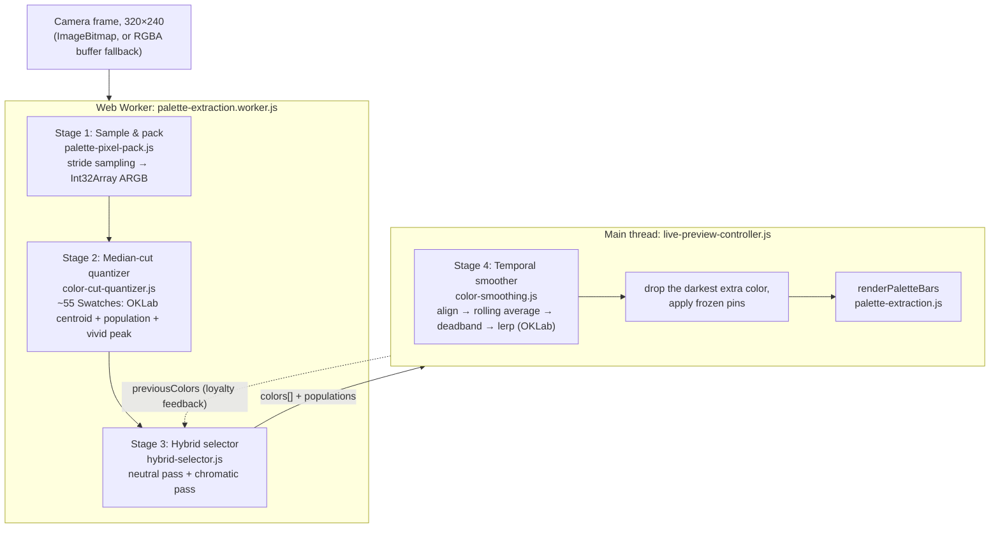
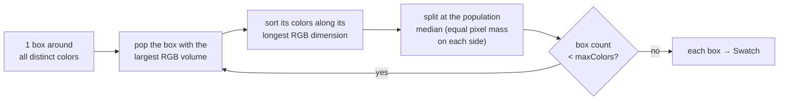
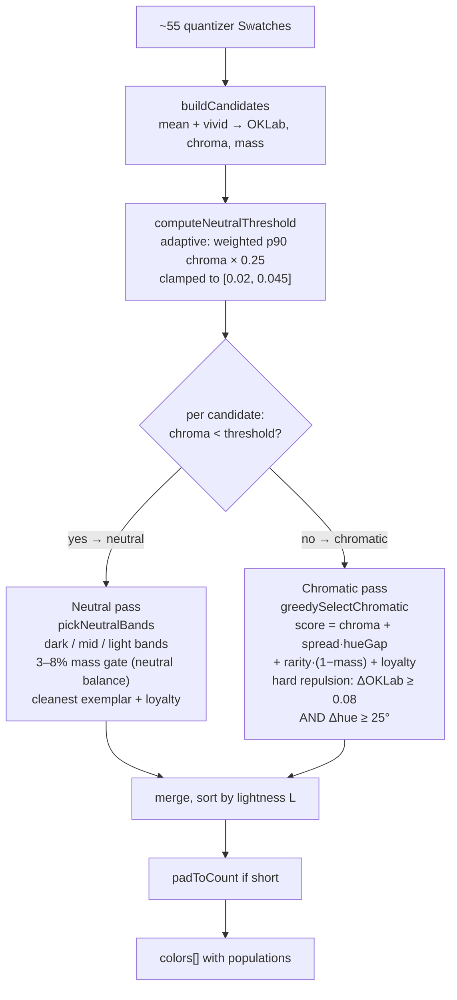
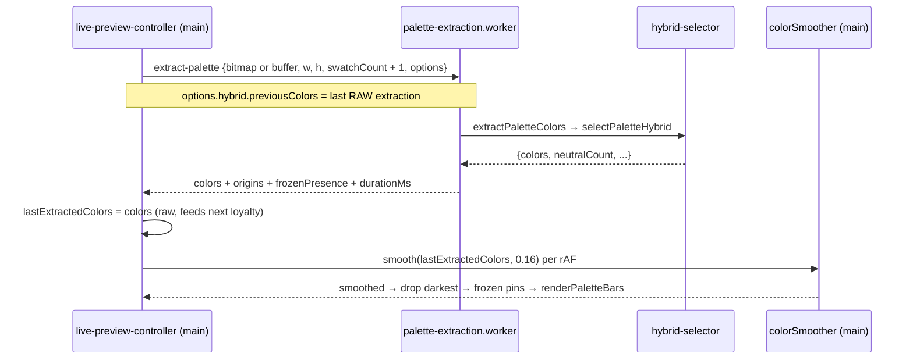

# How the perceptual extraction pipeline works

PaletCam turns each live camera frame into a palette in four stages. This document walks through them like a course: first the theory (color spaces, and why averages mute colors), then every stage of the code and the design decisions behind it.

If you're new, read §1 for the theory and §2 for the map, then §3 to §6 for the four stages in dataflow order. §7 sums up what the pipeline decides from the scene, and §8 describes the removed classic path for contrast.

---

## 1. Theory foundations

### 1.1 sRGB is not a geometric space

Camera pixels arrive as sRGB bytes (0–255 per channel). Two facts make raw sRGB a bad space for palette math:

1. sRGB values are gamma-encoded. A byte value tracks roughly the *perceived* brightness of a color, not the physical light intensity behind it. Because of that, averaging gamma-encoded bytes darkens and distorts mixtures. Converting to **linear sRGB** undoes the gamma curve (`srgbToLinear` in `color-math.js`). The values then measure physical light again, and linear math on them becomes meaningful.
2. RGB is perceptually non-uniform. Even in linear RGB, two pairs of colors at the same Euclidean distance do not look equally different. A distance of 30 between two greens can be invisible, while the same distance between two blues can be obvious. Any threshold tuned in RGB, such as one that decides whether two colors are distinct, is therefore wrong in some region of the color cube.

### 1.2 OKLab: the working space

**OKLab** is a color space that Björn Ottosson introduced in 2020. He designed it so that the Euclidean distance between two colors approximates how different they look. `rgbToOklab` in `color-space-oklch.js` converts a pixel along this chain:

```
sRGB bytes → linear sRGB → LMS cone response (matrix M1) → cube root → OKLab (matrix M2)
```

The LMS step models the response of the eye's three types of cones. The cube root models how that response compresses: it grows more slowly than the light itself. The result is three Cartesian coordinates:

- **L** is lightness, from 0 (black) to 1 (white).
- **a** runs from green (−) to red (+).
- **b** runs from blue (−) to yellow (+).

The vertical L axis, where a = b = 0, is the **neutral spine**: every grey, black and white lies on it. A color's distance from that spine is its chroma, and its angle around the spine is its hue.

### 1.3 OKLCH: the same space in polar coordinates

**OKLCH** is OKLab with the (a, b) plane expressed in polar form. Instead of two Cartesian coordinates, a color gets a distance and an angle:

```
C (chroma) = √(a² + b²)        // how far from neutral
H (hue)    = atan2(b, a)       // which direction (an angle, 0–360°)
```

The two forms lead to a strict rule in this codebase:

> **Do geometry in OKLab. Derive C/H only for semantics.**
> Distance, averaging and clustering all use (L, a, b), whose axes are signed, linear and free of wrap-around. Hue is an angle, so linear math on it breaks at the seam where 360° meets 0°. That break caused the old "reds get mangled" bug. The code computes chroma and hue only to answer questions about colors: "is this neutral?" (C below a threshold) and "are these hues far apart?" (angular gap).

`rgbToOklch` is `rgbToOklab` plus the polar conversion. It describes the same space and answers different questions.

### 1.4 Why averages mute colors

Every classical palette extractor reports the **mean** of a pixel cluster. Real-world color regions are not solid, though. A red mug has highlights, shadows, and edge pixels that blend into the background, so its pixels form a scattered cloud. Averaging that cloud pulls the result toward the grey spine. Chroma is a distance from the spine, and the mean of scattered points always lies closer to the center than the vivid points on the rim. Old PaletCam palettes stacked three averages (the cluster mean, then a temporal mean, then the display lerp), and that is why they looked muddy.

The fix (§5.5) keeps two colors per cluster: the **mean**, which is soft and representative, and the **highest-chroma real pixel**, called the vivid peak. A single **Tone** knob blends between them. The vivid peak is a real observed pixel, so it can't be a color that wasn't in the frame.

### 1.5 Design constraint: live camera, zero tuning

PaletCam is a live tool: extraction runs about 5 times per second on a phone. That imposes three constraints:

- Each extraction has to be cheap. The pipeline bounds pixel counts, uses integer histograms, and does not convert every pixel of the full frame to OKLab.
- The pipeline needs no per-image tuning. Anything that depends on the scene has to be adaptive, meaning the code computes it from the frame instead of exposing a slider. The knobs it does expose (§9) shape taste, and correctness does not depend on them.
- The palette has to stay stable over time, so two near-equal candidates should not make it flip every frame. Two mechanisms handle this: hysteresis in the selection (§5.6) and smoothing on the display (§6).

---

## 2. Map of the pipeline

### 2.1 Dataflow



Two feedback loops keep the live feed calm. The selector receives its own previous output as a stability bias, called loyalty (§5.6). The smoother filters what the user sees (§6).

### 2.2 Files

| File | Role |
|---|---|
| `src/modules/palette-pixel-pack.js` | Stage 1: stride sampling, ARGB packing |
| `src/modules/color-cut-quantizer.js` | Stage 2: median-cut in RGB, OKLab centroids, `Swatch {rgb, population, vividRgb}` |
| `src/modules/hybrid-selector.js` | Stage 3: the perceptual selector, the core of this doc |
| `src/modules/color-smoothing.js` | Stage 4: temporal smoothing on the main thread |
| `src/modules/color-space-oklch.js` | OKLab/OKLCH conversions, including `oklabToRgb` |
| `src/modules/color-math.js` | `srgbToLinear`, `rgbToHsl`, RGB distances |
| `src/modules/palette-extraction.js` | Entry point: defaults + `extractPaletteColors` → `selectPaletteHybrid` |
| `src/workers/palette-extraction.worker.js` | Worker shell: reads the frame bitmap and runs extraction off the UI thread |
| `src/modules/palette-extraction-worker.js` | Main-thread worker controller, with a synchronous fallback |
| `src/modules/app/live-preview-extraction-pipeline.js` | Builds extraction options, keeps the raw result as `previousColors` |
| `src/modules/app/live-preview-controller.js` | Live loop: extraction cadence, smoothing, frozen pins, rendering |
| `src/app-settings.js` | Defaults (`DEFAULT_HYBRID_SETTINGS`, `DEFAULT_MEDIAN_CUT_SETTINGS`) and persistence |
| `src/debug-extraction.js`, `src/modules/debug/*`, `public/debug-extraction.html` | The Palette Extraction Lab, where this pipeline was designed (§12) |

The selector is called hybrid because it combines two sources. Its candidates come from the production median-cut quantizer, which is cheap, integer-based and stable from frame to frame on video. Its perceptual selection logic (OKLab, neutral reservation, repulsion, tone) comes from the experimental prototype in `src/modules/debug/experimental-selector.js`. That debug prototype clustered pixels itself on an OKLab grid. The shipped hybrid reuses the quantizer's boxes as clusters instead.

---

## 3. Stage 1: Sampling & packing

`packImageDataToArgb8888(imageData, w, h, { maxPixels })` in `palette-pixel-pack.js` handles this stage.

The quantizer should not have to process millions of pixels 5 times per second, so the function subsamples the frame with a **square stride**:

```
stride = ceil( √(totalPixels / maxPixels) )
```

Taking every `stride`-th pixel along both x and y keeps the sample spatially uniform. The sample therefore keeps roughly the color distribution of the full frame, and a histogram-based quantizer needs nothing more. `maxPixels` defaults to 46 000 (`DEFAULT_MAX_QUANTIZER_PIXELS` in `palette-extraction.js`, the Density control in §9). The live loop extracts from a 320×240 analysis frame (`DEFAULT_ANALYSIS_MAX_WIDTH` in `live-preview-frame-acquisition.js`, 4:3 crop), which holds 76 800 pixels. With a cap of 46 000 the stride is 2, so the quantizer sees 19 200 samples. Any cap from 19 200 to 60 000 gives the same stride of 2.

The function packs each sampled pixel into one `Int32` as `0xFFRRGGBB`. It skips fully transparent pixels (`alpha === 0`) so they can't pollute the histogram. The output is a throwaway buffer, and that matters because Stage 2 mutates it in place.

---

## 4. Stage 2: Median-cut quantization

`ColorCutQuantizer` in `color-cut-quantizer.js` runs this stage. It descends from Android's Palette API, heavily trimmed. It reduces the ~19 200 live samples to a pool of about 55 candidate clusters, called Swatches, for the selector. The pool size is `max(swatchCount, quantizedPoolSize)`, and `quantizedPoolSize` defaults to 55 (`DEFAULT_QUANTIZED_POOL_SIZE`, the Analyze control in §9).

### 4.1 The histogram: 15-bit color bins

The quantizer reduces each 24-bit RGB pixel to 5 bits per channel (32 levels), which gives 32³ = 32 768 possible bins:

```
r5 = r8 >> 3;  g5 = g8 >> 3;  b5 = b8 >> 3
bin = (r5 << 10) | (g5 << 5) | b5      // 15-bit code
```

One pass over the samples fills the histogram with `histogram[bin] += 1`. Binning collapses sensor noise, because nearby colors share a bin. It also caps all later work at 32 768 entries, whatever the image size. The 128 KB histogram is a module-level **shared buffer**: the quantizer zeroes and reuses it on every extraction instead of reallocating it, since this code runs 5 times per second.

If the image has at most `maxColors` distinct bins, the quantizer returns them directly. Otherwise it runs median-cut.

### 4.2 Median-cut: recursive box splitting

Picture the occupied bins as points in the RGB cube. Median-cut wraps them in boxes (`Vbox`) and keeps splitting the box that most needs it:



Four choices in this loop shape what the selector receives downstream:

- The loop splits the box with the largest volume first, using a max-heap ordered by `getVolume()`. Volume measures color spread, so visually diverse regions get subdivided before big flat ones. That is how a small but distinct color survives as its own box.
- Each split runs along the box's longest dimension, at the population median. Every cut therefore halves the pixel mass, and boxes end up as either a big uniform region or a small distinct region. Both make useful candidates.
- The significant-octet trick (`modifySignificantOctet`) handles sorting along green or blue. It temporarily repacks the 15-bit codes as GRB or BGR, so that a plain numeric `TypedArray.sort()` sorts by the right channel, then packs them back. The trick is cheap and allocates nothing.
- The splits happen in RGB on purpose. Integer bin math is fast, and for video it is also deterministic and stable: a tiny change in the frame moves few bins, so the boxes barely move. An earlier attempt packed OKLCH into the same integers and corrupted reds through hue wrap-around, which is why the "geometry in OKLab, only where it counts" rule exists. Only the box boundaries are RGB. Each box's representative color is averaged in OKLab (§4.3).

### 4.3 What a Swatch carries

`getAverageColor()` reduces each box to:

```js
Swatch {
  rgb,         // population-weighted OKLab CENTROID of the box → the "soft" representative
  population,  // pixel mass (sample counts)                     → the selector's "mass"
  vividRgb,    // highest-OKLab-chroma bin in the box            → the "vivid peak"
}
```

The centroid sums population-weighted L, a and b over the box's bins, and `oklabToRgb` converts the mean to RGB once. Averaging in gamma sRGB instead would darken and grey the mean (§1.1). When the image has no more distinct bins than the pool size, each bin becomes its own Swatch and `vividRgb` equals `rgb`.

`vividRgb` is the hook against muting (§1.4). The mean gives the box's average appearance, while the vivid exemplar is the most saturated color that actually occurred in the box. A bin's OKLab coordinates depend only on its 15-bit code, so `quantizedLabIndex` memoizes them in a lazily filled `Float32Array` with L, a and b interleaved (32 768 × 3 entries). NaN marks an unset entry, because L = 0 is a valid black. The centroid and the vivid peak both read from this cache, so once it has warmed up, live frames pay almost nothing for the conversion.

---

## 5. Stage 3: The hybrid selector

`selectPaletteHybrid(imageData, width, height, swatchCount, params)` in `hybrid-selector.js` runs this stage, the core of the pipeline. Everything in this section works on the ~55 quantizer swatches. That is little data, so the selector can afford real perceptual math. `selectPaletteHybrid` packs, quantizes and builds candidates, then hands them to `selectPaletteCandidates`, which runs both passes. That second function is exported so the lab's Hybrid tab can feed it grid candidates instead of median-cut boxes.



### 5.1 Candidate building

`buildCandidates` turns each Swatch into the selector's working record. It converts both representatives (`meanRgb` and `vividRgb`) to OKLab. The candidate then keeps the mean's `(L, a, b)` flattened on the record, the candidate's chroma `c`, the vivid peak's position `vividLab` and chroma `vividC`, and `mass` (population). Every later decision works on these ~55 records.

### 5.2 The adaptive neutral threshold

The first decision that adapts to the scene is where "neutral" ends and "color" begins. A fixed chroma cutoff fails in both directions, because the same beige wall reads as a color in a drab scene but as the neutral background in a vivid one.

`computeNeutralThreshold` scales the cutoff to the scene's own chroma range:

1. It sorts the candidates by chroma, then walks up the list adding up their mass until they cover 90% of the pixels. The chroma reached at that point is the mass-weighted **90th-percentile chroma** (p90). It measures how chromatic the scene gets. Because it is weighted by pixel population, a few outlier candidates barely move it.
2. The threshold is `p90 × 0.25`, clamped to [0.02, 0.045].

In plain terms, a candidate counts as neutral when it is less than a quarter as chromatic as the vivid end of the scene. The floor (0.02) stops faintly tinted greys from reading as colors in a grey scene, where p90 is tiny. The cap (0.045) stops clearly tinted colors from being absorbed as neutrals in an extremely vivid scene. These values are OKLab chroma units. For scale, a fully saturated sRGB red has a chroma of about 0.26.

Every candidate with `c < threshold` goes to the neutral pass, and the rest go to the chromatic pass. The selector uses two passes because the two groups follow different aesthetics. Neutrals should be clean and span the lightness range, with a good black and a good white. Chromatic picks should be vivid and span the hue circle. A single scoring function can't reward both.

### 5.3 The neutral pass: reserving black & white

Black and white used to be the worst failure. They are massive in most photos but score zero on any chroma or saturation axis, so the old scorers starved them. The fix is **reservation**: neutrals get their own slot budget before the chromatic competition starts.

The user picks one of three **neutral balance** policies (`neutralBalance`, `NEUTRAL_POLICIES` in `hybrid-selector.js`). Each policy sets a slot scale and a band mass floor:

| Policy (UI label) | Slot scale | Band mass floor | Extra rule |
|---|---|---|---|
| `color` (Vivid) | 0.5 | 8% | at most 1 neutral slot when chromatic candidates exist |
| `balanced` (Balanced, default) | 1 | 5% | none |
| `neutrals` (Neutrals) | 1.35 | 3% | requests at least `min(2, cap)` slots when neutral candidates exist |

The slot budget starts from `neutralFraction` = neutral mass / total mass. The requested number of neutral slots is `round(swatchCount × neutralFraction × slotScale)`, capped at `min(swatchCount − 1, 3)` so neutrals can't crowd out all color. The exception is a scene with no chromatic candidates at all, where neutrals get every slot. The policy's extra rule applies after the cap.

`pickNeutralBands` splits the neutral candidates by lightness into three bands: **dark** (L < 0.34), **mid** (0.34–0.66) and **light** (≥ 0.66). They correspond to the black, grey and white a designer would pull. A band earns a slot only if it holds at least the policy's mass floor (`minBandMass`, 5% of total pixel mass under Balanced). That floor removes the invisible anti-aliasing greys that every image contains. The pass then takes bands in order of mass, heaviest first, until the budget is used up. Under Neutrals with 2 or more slots, dark and light come before mid, so the palette gets a black and a white before a grey.

Within each winning band, the pass picks the cleanest candidate as the band's exemplar. Cleanest means the lowest chroma, minus a small loyalty bonus (`chroma − 0.02 × loyalty`, §5.6) that keeps the band from flapping between two similarly clean greys across frames. Under Neutrals the cost also adds `0.04 × L` in the dark band and `0.04 × (1 − L)` in the light band, which favors the deepest black and the brightest white. This is the reverse of the chromatic pass: chromatic picks maximize chroma and neutral picks minimize it, because a neutral has to look convincingly neutral.

The exemplar reports the mass of its whole band as its `population`, rather than its own mass, because it stands for the band.

### 5.4 The chromatic pass: greedy selection with repulsion

`greedySelectChromatic` fills the remaining `swatchCount − neutralPicks` slots. It runs a greedy loop: each iteration scores every remaining candidate against the colors already picked, then takes the best one.

Before the loop starts, the function computes for each candidate its **Tone-blended** color (§5.5), that blend's OKLab position and hue, and two normalizations relative to the scene:

- `chromaNorm = vividC / maxChroma` measures vividness relative to the scene's most vivid candidate, so the mechanism works the same way in pastel and neon scenes.
- `rarityNorm = 1 − mass / maxMass` gives small clusters a high score. It protects the small but salient accent (the pink tray, the yellow sign) that raw mass would bury.

The pass also enforces two hard constraints, together called the **repulsion**. They make a candidate ineligible instead of merely penalizing it. A candidate is ineligible if, for any color already picked:

1. the OKLab distance between the blended colors is below `repulsionRadius` (default 0.08), or
2. the hue gap is below 25° (`hueRadiusDeg`, hardcoded).

Picture a forbidden ball around each pick, plus a forbidden wedge of hue. The ball alone is not enough, because two reds can sit more than 0.08 apart through lightness and still read as red and red. The hue wedge stops one dominant hue from claiming every slot. Hue gaps use the wrap-aware angular distance (`hueGap`: `min(Δ, 360−Δ) / 180`, so 0..1) and never linear subtraction (§1.3).

Among eligible candidates, the score is:

```
score = chromaNorm                       // be vivid
      + spreadStrength × hueSpread       // be a NEW hue (min angular gap to picks, 0..1)
      + rarityStrength × rarityNorm      // champion small clusters
      + loyaltyStrength × loyaltyNorm    // prefer last frame's picks (§5.6)
```

The defaults are `spreadStrength = 0.6`, `rarityStrength = 0.2` and `loyaltyStrength = 0.3`. For the first pick nothing is chosen yet, so `hueSpread = 0` and the winner is essentially the most vivid candidate, nudged by rarity and loyalty.

When no candidate satisfies both constraints, for example in a small palette of near-identical hues or with a generous radius, the loop falls back to **farthest-point selection**. It picks the candidate whose minimum blended-OKLab distance to the chosen set is largest. The constraints soften instead of failing, so you always get the most separated colors available, even when "separated enough" is impossible.

### 5.5 Tone: the anti-muting blend

The selector computes the displayed color of each chromatic pick as:

```js
blendedLab = lerpLab(meanLab, vividLab, tone)    // tone = 0.9 in the app (DEFAULT_HYBRID_SETTINGS)
displayed  = oklabToRgb(blendedLab)
```

- `tone → 0` gives the cluster mean: soft and muted, like a classical extractor.
- `tone → 1` gives the highest-chroma real pixel: as vivid as possible, and guaranteed to have existed in the frame.

At 0.9 the palette leans strongly vivid, and the remaining 10% of mean tames single-pixel extremes. The selector's own fallback is 0.85, used only when the caller passes no tone. This one number replaces what used to take per-image weight tuning. Two details are easy to miss:

- The selector computes the blend before scoring and repulsion, and both of those work on the blended color. The selector therefore keeps apart the colors the user will see, rather than the abstract cluster means.
- The lerp runs in OKLab, like every other perceptual judgment in this pipeline, because a gamma-sRGB lerp would darken and grey the midpoint. The blended Lab point feeds the geometry directly. `oklabToRgb` converts it once, clamping each channel when the blend lands slightly outside the sRGB gamut. Neutrals skip the blend: their `meanRgb` ships as-is, since a vivid neutral is a contradiction.

### 5.6 Loyalty: selection hysteresis

On a live feed, two near-equal candidates (score 0.612 vs 0.609) can trade places every frame, and the palette flickers while the scene stays still. **Loyalty** biases the race toward the colors already in place:

- The controller passes the previous raw extraction as `previousColors` (see `buildOptions` in `live-preview-extraction-pipeline.js`). It passes the raw colors, not the smoothed ones, so the two stability systems don't feed back into each other.
- `computeLoyalty` turns a candidate's distance to the nearest previous color into a bonus. The bonus is 1 at distance 0 and fades linearly to 0 at an OKLab distance of `LOYALTY_RADIUS = 0.1`.
- The chromatic score weights this bonus by `loyaltyStrength` (0.3). In the neutral pass, the bonus subtracts up to `0.02` chroma units from the exemplar cost.

This is **hysteresis** in the textbook sense: the current state gets a bonus, so a switch needs a clearly better challenger instead of a coin flip. When the scene changes, the new candidates are far from every previous color, loyalty drops to 0 everywhere, and the palette switches freely. `hybrid-selector.test.js` pins both properties ("rerunning with its own output as previousColors is stable", "loyalty steers a near-equal pick toward the previous palette").

### 5.7 Assembly: sort & pad

The selector merges the neutral and chromatic picks and sorts them by OKLab lightness L. That gives the familiar dark-to-light bar order, and it also keeps bar positions more stable across frames than score order would.

Sometimes there are fewer picks than `swatchCount`: in a low-variety scene, repulsion and the hue wedge can use up the pool. `padToCount` then fills the gap from the remaining chromatic candidates (tone-blended, deduplicated), and as a last resort it duplicates the final color. The app renders a fixed number of bars, so the contract is "always exactly N colors". An earlier design question, "pad or show fewer?", was settled in favor of padding.

The selector returns `{ colors, candidates, neutralCount, neutralThreshold }`. The fields beyond `colors` feed the debug harness's stats footer and overlays.

---

## 6. Stage 4: Temporal smoothing

`createColorSmoother()` in `color-smoothing.js` runs this stage on the main thread, on the display side. Loyalty (§5.6) stabilizes which colors get picked. The smoother stabilizes what the user sees between and across extractions, which arrive about 5 times per second while rendering runs at `requestAnimationFrame` (rAF) rate.

The smoother applies four mechanisms, in the order below. All four run in OKLab. The working state stays in Lab floats, and colors convert to sRGB only at output, because an 8-bit round-trip every frame would drift and make the deadband oscillate.

1. **Alignment** (`reorderToMatchReference`) comes first. The order of the extraction output carries no identity, so the smoother greedily matches incoming colors to the previous palette's slots, closest pair first, by ΔEOK (Euclidean OKLab distance). Without this step, two swatches that swap positions would both look like they changed color.
2. A **rolling average** over the last `ACCUMULATOR_MAX_SIZE = 5` aligned extractions (~1 s of history) filters out single-frame sensor noise.
3. A **deadband** ignores small changes. If a slot's target is within `COLOR_DISTANCE_THRESHOLD = 0.04` ΔEOK of the displayed color, the smoother returns the same color object. Shimmer below the threshold then produces no visual change, and the controller skips the repaint. 0.04 is about twice the just-noticeable difference of 0.02, and close to the old RGB threshold of 24.
4. A **lerp** (linear interpolation) takes over past the deadband. Each frame, the displayed color eases toward the target by `lerpFactor` instead of jumping. The live preview passes `PREVIEW_SMOOTHING_FACTOR = 0.16`.

Once a slot crosses the deadband, it ignores the deadband for the next 5 new extractions and keeps easing. It snaps onto the target when it gets within `SETTLE_DISTANCE = 0.01`. Without that rule, the lerp stopped as soon as the color entered the deadband, so swatches, and the catches saved from them, stayed up to 0.04 short of the extracted color.

Step 2 is an average, which is what §1.4 warns about. The selector resolves this upstream: its tone blend puts the raw colors far from the grey spine to begin with, and averaging 5 frames of a color that is already vivid and held steady by loyalty barely moves it. A chroma floor on the smoothed output remains an open idea.

`live-preview-controller.js` owns one smoother instance and resets it when the camera restarts. `createColorSmoother({ colorSpace: "srgb" })` returns the superseded RGB smoother, kept only for the lab's Legacy sRGB tab.

---

## 7. Adaptivity: what the pipeline decides from the scene

Adapting to the scene is the pipeline's defining property, so this table collects those decisions in one place:

| Decision | Mechanism | Where |
|---|---|---|
| Where "neutral" ends | mass-weighted p90 chroma × 0.25, clamped [0.02, 0.045] | `computeNeutralThreshold` |
| How many neutral slots | proportional to neutral pixel mass × policy slot scale, cap min(N−1, 3) | `selectPaletteCandidates` |
| Which neutrals qualify | lightness band must hold the policy's mass floor (3/5/8%) | `pickNeutralBands` |
| What counts as "vivid" | `chromaNorm` normalized to this scene's max chroma | `greedySelectChromatic` |
| What counts as "rare" | `rarityNorm` normalized to this scene's biggest cluster | `greedySelectChromatic` |
| When constraints yield | repulsion relaxes to farthest-point when unsatisfiable | `greedySelectChromatic` fallback |
| Sampling density | stride from frame size vs `maxQuantizerPixels` | `computePixelStride` |
| Where clusters form | median-cut spends splits on high-volume (diverse) regions | `Vbox` heap |
| What changes frame-to-frame | loyalty to the previous extraction, and the smoother deadband | §5.6, §6 |

The debug prototype also had `suggestSelectorParams`, which set Variety and Distinctness automatically from hue concentration and ab-spread. The shipped app uses fixed selector weights instead, because the adaptive normalizations above turned out to do most of the work.

---

## 8. The classic path (removed, kept for contrast)

The old selector (`palette-extract-median-cut.js` and `palette-scoring.js`, the `paletteSelector: "current"` mode) was deleted in July 2026, and the perceptual selector is now the only pipeline. Knowing how the old one worked still clarifies what the hybrid fixed.

It used the same Stages 1 and 2. Then `rankQuantizedCandidates` greedily maximized a **weighted sum** of four normalized scores: chroma (HSL saturation), luma spread (distance from mid-lightness), hue rarity (inverse histogram over 12 hue buckets) and diversity (min RGB distance to picks). That sum was mixed 85/15 with a log-scaled population score. The scorer also held a dormant `"perceptual"` scoring model that swapped HSL for OKLCH features. Don't confuse it with the perceptual selector, which bypasses this scorer entirely.

Structural differences from the hybrid, and their consequences:

| Classic | Hybrid | Consequence |
|---|---|---|
| diversity is a soft score term | repulsion is a hard constraint, plus the hue wedge | classic can pick near-duplicates when other terms dominate, while hybrid can't |
| neutrals compete on the same axes | neutrals get reserved slots and the opposite objective | classic starves black and white, while hybrid guarantees them proportional presence |
| displays box means | tone-blends toward the vivid peak | classic mutes, while hybrid doesn't |
| 4 interacting weights to tune per image | scene-adaptive internals + taste knobs | classic needs hand-tuning, while hybrid works well at its defaults |
| no memory of the previous frame | loyalty hysteresis | classic relies wholly on the smoother for stability |

---

## 9. The control surface

The tune panel (`src/modules/panels/config-panel.js`, `tune-panels.js`) exposes four controls. `src/app-settings.js` holds their defaults and persists them per user:

| Setting | Default | Range | UI name and meaning |
|---|---|---|---|
| `hybrid.neutralBalance` | `balanced` | `color` / `balanced` / `neutrals` | **Neutral balance** (Vivid, Balanced, Neutrals): the neutral policy in §5.3 |
| `medianCut.quantizedPoolSize` | 55 | 4–64 | **Analyze**: candidate pool size (§4) |
| `medianCut.maxQuantizerPixels` | 46 000 | 1 000–60 000 | **Density**: sample cap (§3). On the 320×240 live frame, every value from 19 200 up gives stride 2. |
| `hybrid.tone` | 0.9 | 0–1, shown as 0–100% | **Tone**: soft cluster mean ↔ vivid real pixel (§5.5) |

The other selector weights stay in `DEFAULT_HYBRID_SETTINGS` with no UI. `loadSettings()` drops any stored value for them, so sliders from old builds can't pin stale numbers:

| Param | Fixed value | Role |
|---|---|---|
| `spreadStrength` | 0.6 | weight of the new-hue bonus |
| `repulsionRadius` | 0.08 | minimum OKLab separation between picks |
| `rarityStrength` | 0.2 | small-cluster champion weight |
| `loyaltyStrength` | 0.3 | hysteresis strength on a live feed |

Some internals are fixed on purpose and have no knob: the hue wedge (25°), `LOYALTY_RADIUS` (0.1), `NEUTRAL_LOYALTY_WEIGHT` (0.02), the neutral band edges (0.34/0.66), the threshold clamps ([0.02, 0.045]) and the neutral cap (3). Each value was settled empirically in the harness across ~216 test images. Turning them into settings would bring back the tuning problem the redesign exists to remove.

Accents under ~0.1% of pixels, such as tiny text or LEDs, are out of scope on purpose. At the live loop's 19 200 samples, 0.1% is about 19 pixels, which is indistinguishable from noise. Chasing them would inject speckle everywhere.

---

## 10. Worker & app wiring



`extractPaletteColors` (`palette-extraction.js`) applies the pool-size and pixel-budget defaults (55 and 46 000) and calls `selectPaletteHybrid` directly. The worker also computes swatch **origins**, which say where in the frame each color lives, for the origin badges. It computes **frozen presence** too, which says whether a pinned color still exists in view. Both are outside this doc's scope, but they ride the same message.

The controller asks for one color more than the user's count (`getEffectiveSwatchCount`, since `oneMoreColor` is forced on in `loadSettings()`). After smoothing, `removeDarkestColor` drops the darkest one, and frozen pins replace their slots. At count 1 this pipeline does not run. Single color mode instead samples a small patch under a center crosshair 10 times a second (`readCenterColor`).

Where the browser allows it (`canReadFramesOffThread`, which excludes the iOS canvas-preview path), the controller grabs a 320×240 `ImageBitmap` with `createImageBitmap` and transfers it. The worker draws it to an `OffscreenCanvas` and reads the pixels there, so the main thread does not block on a GPU readback. Otherwise the controller reads the analysis canvas itself and transfers the RGBA buffer, or extracts synchronously when the worker is unavailable. Either way `selectPaletteHybrid` packs a fresh buffer, which is why the quantizer is allowed to mutate it: during histogramming it overwrites pixels with their 15-bit codes. Pass a copy if you ever reuse a packed buffer. `extraction-trace.js` packs its own buffer for the scatter and lets `selectPaletteHybrid` pack another.

---

## 11. Gotchas & invariants

- Don't do linear math on hue, because angles wrap. Use `hueGap`-style angular distance, or stay in Cartesian (a, b). This bug has shipped once already.
- The quantizer mutates its input (§10). The `packed` buffer in `selectPaletteHybrid` is fresh on each call, so the mutation is safe there.
- `previousColors` must be the raw extraction, not the smoothed display colors. Otherwise loyalty and the smoother form a feedback loop that can wander away from the real scene.
- Neutral picks report band mass, not exemplar mass (§5.3). Population consumers, such as the origin badges and sorting, rely on this.
- The output length is always exactly `swatchCount`, which padding guarantees. In pathological low-variety scenes, `colors` may contain duplicates.
- The OKLab lookup table (LUT) and the shared histogram are module-level state. That is fine in the worker, which is a single realm. Two concurrent quantizers in one realm would race on the histogram, each zeroing and filling the same buffer. By design, only one extraction is in flight at any time.
- Tone has a subtle effect on tight clusters (mean ≈ peak) and a pronounced one on broad regions of real photos. Don't judge it on synthetic flat-color tests.

## 12. Where the tests point

- `hybrid-selector.test.js` covers the selector contract: exact count with populations, self-stability under loyalty, loyalty steering, dark and light anchors under the Neutrals balance, and degenerate input.
- `color-cut-quantizer.test.js` covers distinct-color passthrough, the `maxColors` cap, population, and the sRGB-centroid replay. No test covers `vividRgb` yet.
- `color-smoothing.test.js` covers first-frame passthrough, landing past the deadband, settled swatches keeping the same object, reset, per-instance state and sRGB replay.
- `color-math.test.js` and `palette-extraction.test.js` cover the primitives and the entry-point contract (guards, option forwarding, neutral balance).

The harness, the Palette Extraction Lab, remains the best learning tool. Run `bun run dev` and open http://localhost:3000/debug-extraction.html. The lab shows every §5 concept (neutral spine, repulsion balls, candidates vs picks, threshold stats) in 3D, on your own images.

- Preprod builds include the lab, and production builds drop it (`scripts/build.js`, `DEBUG_ONLY_PUBLIC_EXACT_PATHS` in `scripts/build-policy.js`).
- The gallery lists `public/assets/img/**` through `GET /debug/images.json`, a route only `scripts/dev-server.js` serves. Images under `sets/<Name>/` are grouped by set.
- Five tabs compare pipelines on the same frame (`PIPELINES` in `extraction-lab-model.js`): Legacy sRGB (the superseded sRGB centroid, Tone and smoothing), Production, Grid RGB and Grid Lab (the OKLab grid prototype with sRGB or OKLab Tone), and Hybrid (grid candidates through the production selector).
- The scatter orbits on left-drag, pans on right-drag or Shift-drag, zooms 0.2× to 12× on the wheel, and resets on double-click (`oklab-scatter.js`).
